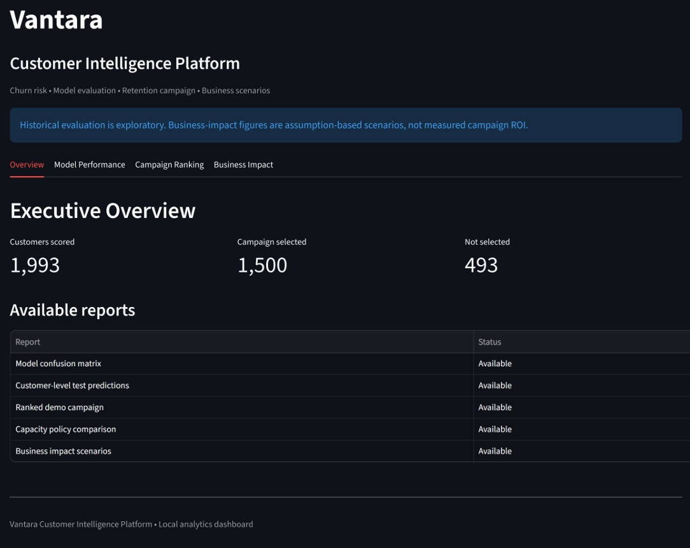

# Vantara — Customer Intelligence Platform

**Predict customer churn. Understand customer behavior. Prioritize retention campaigns.**

Vantara is a machine learning-powered customer analytics platform that helps businesses identify potential churn risks, segment customers, prioritize retention campaigns, and explore business-impact scenarios.

## Key Features

- **Churn Prediction:** Estimate customer churn probability using machine learning.
- **RFM Segmentation:** Analyze customers using Recency, Frequency, and Monetary value.
- **Campaign Prioritization:** Rank customers by predicted churn risk and select a target campaign group.
- **Model Evaluation:** Explore classification metrics and time-based evaluation.
- **Business Impact Analysis:** Evaluate hypothetical retention campaign scenarios.
- **Interactive Dashboard:** Explore customer intelligence and reports using Streamlit.
- **Automated Tests:** Validate campaign reports, customer IDs, prediction probabilities, and campaign capacity.

## Technology Stack

Python 3.10 · Pandas · NumPy · Scikit-learn · Random Forest · Streamlit · Git

## Project Structure

```text
customer-behavior-prediction/
├── frontend/
│   └── vantara_dashboard.py
├── models_artifacts/
├── reports/
├── src/
│   ├── features/
│   ├── models/
│   └── segmentation/
├── tests/
├── requirements.txt
└── README.md

``## Dashboard Preview

### Executive Overview



The dashboard summarizes customer churn scoring, campaign selection capacity, and available business intelligence reports.

The dashboard summarizes customer churn scoring, campaign selection capacity, and available business intelligence reports.

## Getting Started

### 1. Clone the repository

```bash
git clone https://github.com/Mrsingh1012/vantara-customer-intelligence-platform.git
cd vantara-customer-intelligence-platform
```

### 2. Create a Python environment

On Windows PowerShell:

```powershell
py -3.10 -m venv .venv310
.\.venv310\Scripts\python.exe -m pip install --upgrade pip
.\.venv310\Scripts\python.exe -m pip install -r requirements.txt
```

### 3. Generate demo customer features

```powershell
.\.venv310\Scripts\python.exe src/models/build_demo_customer_features.py
```

### 4. Generate campaign rankings

```powershell
.\.venv310\Scripts\python.exe src/models/predict_churn_campaign.py --input data/processed/churn_customer_features_demo.csv --output reports/churn_campaign_ranked_demo.csv --top-k 1500
```

### 5. Launch the dashboard

```powershell
.\.venv310\Scripts\python.exe -m streamlit run frontend/vantara_dashboard.py
```

Open `http://localhost:8501` in your browser.

### 6. Run automated tests

```powershell
.\.venv310\Scripts\python.exe -m unittest discover -s tests -v
```

Generate the demo reports required by the tests before running them.

## Current Demo Snapshot

- Customers scored: 1,993
- Campaign selection capacity: 1,500
- Customers not selected: 493

These figures describe the current demo output and may change when the input data or model changes.

## Evaluation and Limitations

- Historical model evaluation is exploratory; the test period has already been inspected during development.
- Business-impact figures are based on assumptions and do not represent measured ROI.
- Campaign rankings indicate predicted risk, not guaranteed customer churn or guaranteed retention outcomes.
- Production use requires further validation, monitoring, data-quality checks, and real campaign experiments.

## Future Improvements

- Evaluate an untouched temporal holdout.
- Add explainable AI and model monitoring.
- Expand automated tests.
- Integrate real-world data pipelines.
- Measure campaign effectiveness through controlled experiments.

## Author

**Anand Singh**

GitHub: [@Mrsingh1012](https://github.com/Mrsingh1012)

---

*Built as a customer analytics and machine learning portfolio project.*